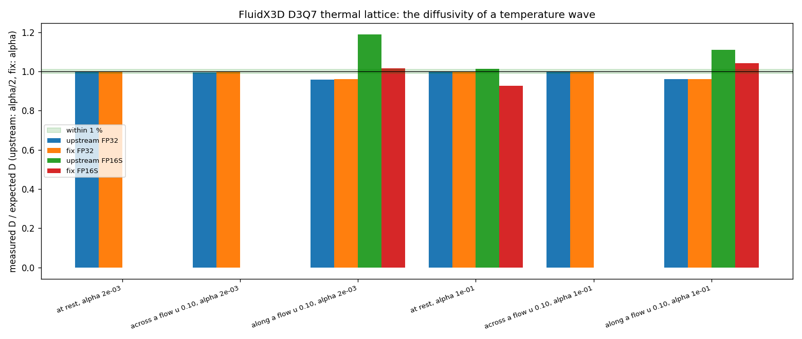
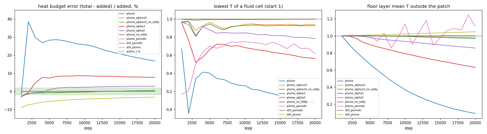
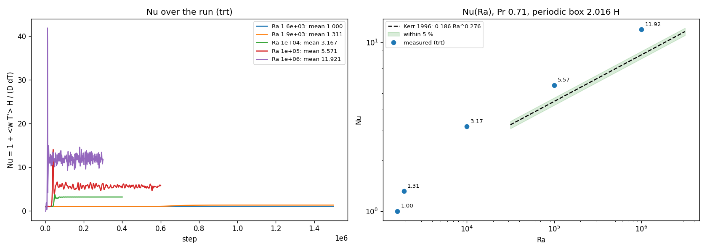
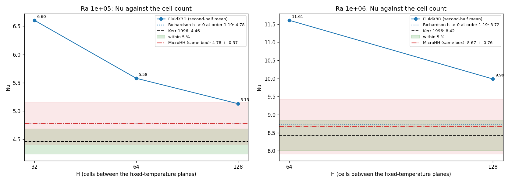
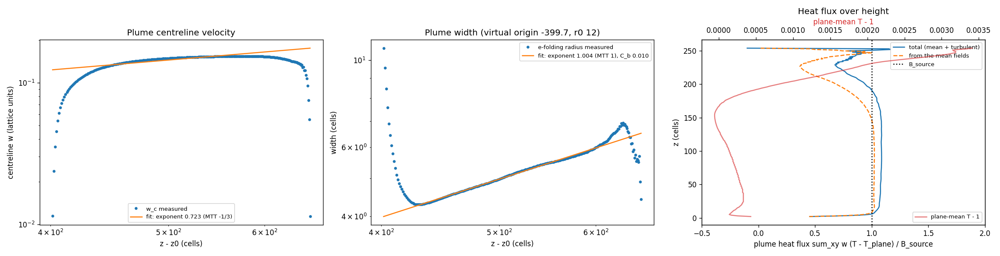
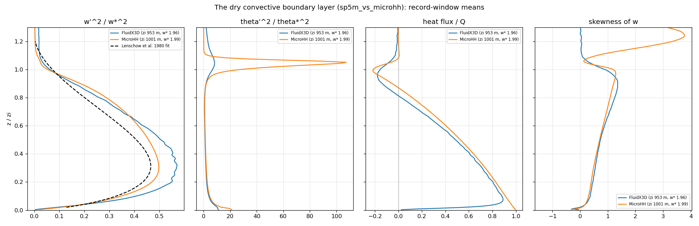
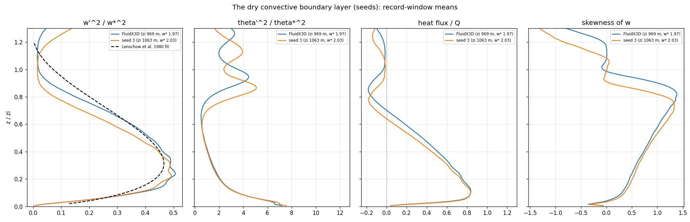

# Atmospheric convection in FluidX3D: fixes, extensions and a conservative scalar transport

This page describes what this fork adds to FluidX3D for thermal convection, and what it fixes. It covers the dry and
moist convective boundary layer (CBL) of the atmosphere: a heated ground, a capping inversion, a mean wind and
cumulus clouds. Every number on this page comes from a test in [`tests/physics`](../../tests/physics) or from the
example [`convective_boundary_layer`](../../examples/convective_boundary_layer). All runs used one RTX 4090.

The references for the atmospheric cases are the large-eddy simulation (LES) literature and the LES code MicroHH
(van Heerwaarden et al. 2017), which I ran on the same cases.

## Summary

- **A bug fix:** the D3Q7 thermal lattice diffused heat at half the requested rate. `THERMAL_DIFFUSIVITY_FIX` makes
  `alpha` the diffusivity.
- **New thermal features:** a surface heat flux, an eddy heat diffusivity for `SUBGRID`, per-level forcing (wind
  nudging and a sponge layer), and moisture with condensation and virtual-temperature buoyancy.
- **A new scalar transport:** heat and water by finite volumes (`SCALAR_FV`), in conservative form with the LBM's own
  link mass fluxes. On the GPU it keeps the heat budget of a buoyant plume within 0.1 % and a uniform field uniform to
  float rounding. The stock D3Q7 lattice and a finite-volume scheme in advective form do not. It costs 1.66 times the
  D3Q7 lattice's time per step and 16 % less memory.
- **A validation suite:** Rayleigh-Benard convection with grid refinement, a plume, the heat budget, the dry CBL
  against the LES laws and MicroHH, and moisture tests.
- **A debugging aid:** `DEBUG_PROBE` writes every cell's state of a step to the host, so a host reference can check
  the GPU bit for bit.

## Defects found in FluidX3D

| Defect | Measurement | State in this fork |
|---|---|---|
| The D3Q7 thermal lattice diffuses with `alpha / 2`. The code sets `def_w_T = 1 / (2 alpha + 1/2)`, but the D3Q7 diffusivity is `(tauT - 1/2) / 4`. | A decaying temperature wave gives D = 0.5007 alpha. | Fixed behind `THERMAL_DIFFUSIVITY_FIX` (`def_w_T = 1 / (4 alpha + 1/2)`, D = 1.000 alpha). The fix is off by default, so the upstream examples run as upstream. |
| `FP16S` storage does not work with `TEMPERATURE`. The thermal DDFs do not diffuse a wave (D = 0 at alpha 2e-3). The range-shifted half floats overflow above T = 8. | `thermal_diffusivity_fp16s` | Documented. Use FP32 for thermal cases. |
| Next to `TYPE_S` walls in a buoyant flow, the thermal lattice creates heat and negative temperatures when `tauT` is close to 1/2. | At `tauT` 0.503: +39 % of the added heat after 2000 steps. With the force-corrected equilibrium of upstream v3.8, the error is 3.3 % or less at `tauT` 0.508 to 0.528 (`heat_conservation`). | Documented. Use `tauT >= 0.556` (alpha >= 0.014 with the fix). |
| The D3Q7 scalar lattices do not keep a uniform scalar uniform when the flow is not divergence-free on the 7-point stencil. The LBM flow conserves mass on its own D3Q19 links, not on 7 points. | In 2700 s of a CBL at 10 m cells, a uniform passive scalar drifts by 7.9 % (calm) and 8.7 % (wind). A host reference gives the same result as the GPU, bit for bit (`scalar_reference`). | A property of the scheme, not a code defect. The finite-volume transport below replaces the lattice. |
| `LBM::initialize()` did not write the moisture field to the device (this fork's `MOISTURE`). | `moist_bubble` | Fixed. |
| The example CMake function wrote the `defines.hpp` of every target into one folder. Two targets in one example folder used the same file. | | Fixed: one `defines_<target>/` folder per target. |

*The measured diffusivity divided by the expected one: stock (alpha/2) and with the fix (alpha), FP32 and FP16S, at
rest and in a flow (`thermal_diffusivity`, `thermal_diffusivity_fixed`, `*_fp16s`).*

## New features and how to use them

Each feature is a compile-time extension in the example's `CMakeLists.txt` (`EXTENSIONS ...`) or in
`defines.hpp`.

| Feature | What it does | How to use it | Test |
|---|---|---|---|
| `THERMAL_DIFFUSIVITY_FIX` | Makes `alpha` the diffusivity of the thermal lattice. | Add the extension. Set alpha as the real diffusivity in lattice units. | `thermal_diffusivity_fixed` |
| Heat source in `TYPE_Y` cells | Adds a heat flux as a source in the first fluid layer, instead of a fixed temperature. `TYPE_X\|TYPE_Y` marks a patch with 4 times the rate. | Flag the cells `TYPE_Y`. Call `lbm.set_heat_rate(rate)` (temperature per step and cell). | `heat_source`, `heat_conservation` |
| Eddy heat diffusivity | With `SUBGRID`, the Smagorinsky eddy viscosity also mixes heat and water, at a turbulent Prandtl number. | `lbm.set_inv_prandtl_t(1/Pr_t)`, for example 3 for Pr_t = 1/3. | `eddy_heat_diffusivity` |
| `LEVEL_FORCING` | Per horizontal level: a force (fx, fy), a damping of w and a temperature relaxation toward T_ref at the same rate. The buoyancy uses the level's T_ref, so the lattice holds no hydrostatic ramp. Uses: wind nudging toward a profile, and a sponge layer under the lid. | `lbm.set_level_forcing(fx, fy, rate, T_ref)`, one value per level, at any time. | `level_forcing` |
| `MOISTURE` | Carries total water qt as Q = 1 + qt / 0.01 on a second scalar, with the thermal diffusivity and a surface source. With `LEVEL_FORCING`, the buoyancy comes from the virtual potential temperature after a saturation adjustment in each cell (Newton on the liquid-water potential temperature). | `lbm.set_moisture_rate(rate)` for the `TYPE_Y` source, `lbm.set_theta_0(theta)`, `lbm.set_level_moist(pressure, theta_v_ref)` per level. | `moisture_source`, `moist_buoyancy`, `moist_bubble` |
| `SCALAR_FV` | Carries T and Q by finite volumes in conservative form, beside the unchanged LBM flow. The LBM's own link mass fluxes move them. Runs in any number of domains. | Add the extension with `TEMPERATURE` and `THERMAL_DIFFUSIVITY_FIX`. The API stays the same. `LBM::time_fv_step()` runs one step and returns the time of each kernel. | `scalar_fv_kernel_check`, `scalar_fv_wall_exchange`, `scalar_fv_cross_lab`, `scalar_fv_timing`, the `*_fv` tests |
| `DEBUG_PROBE` | Writes the state of every cell of a step (density, velocities, forces, relaxation rates, T, Q, fluxes), a ring of 256 steps of one cell's populations, and the DDFs to the host. One domain. | `lbm.debug_cells()`, `lbm.debug_trace()` with `lbm.set_trace_cell(x, y, z)`, `lbm.debug_populations()`; read them with `read_from_device()` after a step. | `scalar_reference`, `scalar_fv_link_flux` |

The example `convective_boundary_layer` uses all of them. It simulates a CBL in physical units and writes the
horizontal-mean statistics and frames of the flow in a box. Run it without arguments to see its cases: a default
case, `sp2011` (the dry CBL of Sullivan and Patton 2011) and `sounding` (a CBL on a tabulated start sounding, with a
sponge layer and an optional wind). The options:

- `--alpha` sets the molecular diffusivity of T and Q. With `SCALAR_FV` the default is 1e-4. The D3Q7 builds refuse
  less than 0.014.
- `--tracer` starts a uniform passive scalar in Q.
- `--moist` with `--zi` takes the total water from the sounding's `qt_kgkg` column and adds the floor's moisture
  flux (Bowen ratio 0.5). It writes the clouds: the cloud fraction per level, a `CLOUD` line per interval and the
  liquid-water bits of the frames.

The target `convective_boundary_layer_fv_fp16s` stores the DDFs as `FP16S`.

## Heat and water by finite volumes

### Why the D3Q7 lattice is replaced

A CBL at LES resolution needs a small diffusivity. That means `tauT` of about 0.556 and an over-relaxed collision
(wT 1.8). In this regime the D3Q7 lattice with its linear equilibrium moves a uniform scalar wherever the 7-point
divergence of the flow is not zero. The over-relaxation makes the error 2.6 times larger. For water the effect is
direct: 8 % of 10 g/kg is 0.8 g/kg, and that is enough to move a cloud base.

### Why not the advective form

The finite-volume scalar of ProLB (Feng et al. 2021, sect. 3.2, eqs 42 to 46) uses the advective form `u . grad(phi)`
with the LBM velocity. That form keeps a uniform scalar uniform, but it is not conservative. Summed over the box,
`u . grad(phi)` leaves the term `phi div(u)`, and the LBM velocity is not divergence-free on 7 points. Measured on the
GPU with buoyancy: the heat in the plume heat-budget case grows by 28 % (161 % without eddy diffusivity). The
host reference `FiniteVolumeScalar` keeps this form for comparison (`scalar_fv_prototype`, `scalar_fv_lab`).

`SCALAR_FV` keeps ProLB's face values and time step:

- upwind MUSCL face values with kappa = 1/3 and the van Albada limiter `phi(r) = 2r / (1 + r^2)`,
- centred 7-point diffusion with face diffusivities `(D_i + D_i+1) / 2`, where D includes the eddy diffusivity,
- a midpoint time step. Explicit Euler adds an anti-diffusion of `u^2 dt / 2` along the flow: D/alpha is 0.671 at
  alpha 0.014 and u 0.1. The midpoint step gives 1.026 (`scalar_fv_lab`),
- the shifted fields T - 1 and Q - 1 (a float keeps the small changes of one step there).

### The conservative form with the LBM's own mass fluxes

To keep both properties, the scalar equation must use the same mass transport as the LBM (Guo et al. 2021, Zhao et
al. 2020). The scheme carries `rho_FV` and `rho phi`, and moves them with the net mass on each of the 18 D3Q19 links.
The net mass comes from the post-collision populations (Dubois and Lallemand 2008, Zhao et al. 2020 eq 18):

    psi_i(x) = f*_i(x) - f*_ibar(x + c_i)                    (the net mass from x to x + c_i in one step)
    rho_FV(t + 1) = rho_FV(t) - sum_i psi_i(x)
    (rho phi)(t + 1) = (rho phi)(t) - sum_i psi_i(x) phi_face,i + diffusion + sources
    phi = (rho phi) / rho_FV

`phi_face,i` is the upwind MUSCL value along the link, chosen by the sign of `psi_i`. The scheme has these properties:

- **Conservation.** `psi_ibar(x + c_i) = -psi_i(x)` exactly. So the flux of a link leaves one cell and enters the other
  cell. The sum of `rho phi` changes only by the sources.
- **Uniformity.** For a uniform phi = c, `rho phi` changes by exactly c times the change of `rho_FV`. So phi stays c.
- **Consistency.** `rho_FV` is the scheme's own density (Guo et al. 2021, eq 17). Away from walls it equals the LBM
  density, because the LBM density changes by the same link fluxes.
- **Time step.** The midpoint step uses the fluxes of the step in both stages. So the properties hold in each stage.

FluidX3D streams with Esoteric-Pull (Lehmann 2022). The populations that the next step loads are `f*_i(x - c_i)`.
So all 18 fluxes come from the DDFs that a step stores.

**Next to walls.** The scheme has no flux on a link to a `TYPE_S` cell (an instant bounce-back). The LBM returns a
population sent into a wall two steps later. So next to walls `rho_FV` differs from the LBM density by the mass in
transit in the bounce-back. The change of this difference matches the change of the in-transit populations to 1.2 %
(`scalar_fv_wall_exchange`, largest change 5.8e-4). It is bookkeeping: conservation and uniformity are not affected.

**The kernel.** After `stream_collide`, two kernels run the midpoint step. The half stage computes the 18 link fluxes
of a cell from the DDFs and writes the half-step fields. The full stage computes the fluxes again and adds the
sources: the `TYPE_Y` heat and water, and the sponge relaxation of `LEVEL_FORCING`. Then it writes `rho_FV`, `rho phi`,
phi and T (Q) in place. In place is safe: in the full stage a cell reads these fields only at its own index. It reads
its neighbours only in the half-step fields. T and Q share one pass over the links. With `SCALAR_FV` the D3Q7 buffers
are one-cell placeholders.

**Domains.** A face value reads along each link the cell behind and the cell 2 ahead. Both cells of a face compute
its flux from the same four values. So both domains must see the same values 2 cells across a cut. With
`SCALAR_FV` the domain halo is 2 cells wide (`def_H`). The LBM fields keep their 1-layer exchange. The finite-volume
stages run after the exchange of the DDFs. These finite-volume fields go across the cuts:

- T and Q after the full stage, 2 layers,
- their half-step values after the half stage, 2 layers,
- the diffusivity, 1 layer,
- the flags, 2 layers, once at the start.

The D3Q7 placeholders do not go across. `scalar_fv_domains` puts a warm moist blob across the cuts, in a diagonal
flow with a source and `SUBGRID`. 2 x 1, 1 x 2 and 2 x 2 domains are bit-identical to one in T, Q and u. Without
the half-step exchange, all three splits fail.

### Results

Host references on the GPU's flow of the plume heat-budget case (64 x 64 x 128, a heated patch, 20000 steps):

| Scheme | Heat against the added heat | Uniform Q | rho_FV / rho_LB - 1, away from walls |
|---|---|---|---|
| D3Q7 lattice (stock) | +17 % to -18 % at `tauT` 0.503 | drifts (8 % in a CBL) | - |
| Advective finite volumes | +28.4 % (+161 % without eddy diffusivity) | exact | - |
| Conservative, 7-point face mass flux | -0.28 % at step 700 | exact | 0.70 at step 700: not usable |
| **Conservative, LBM link fluxes** | **-0.07 % (-0.14 % without eddy diffusivity)** | **1.2e-15** | **4.3e-5** |

The link fluxes give the LBM's density change to 1.3e-7 (float rounding) in every cell without a solid neighbour.
This checks the Esoteric-Pull indexing.

**The kernel against its host twin** (`scalar_fv_kernel_check`). The test runs a moist thermal for 1400 steps and
compares every cell and step. The host twin gets the GPU's own DDFs. T agrees within 2.8e-7 and Q within 6.6e-7,
relative to the stored value. A uniform water field stays uniform to 2.3e-8 kg/kg (the D3Q7 lattice: 1.6e-4). The Q difference is float rounding: it
scales with the size of Q (2.4e-6 at Q - 1 = 2.6, 2.4e-7 at 0.36).

**The physics tests on the kernel:**

| Test | Result |
|---|---|
| `heat_source_fv`, `moisture_source_fv` | the added heat and water within 0.001 % (limit 0.1 %) |
| `heat_conservation_fv` | the total heat against the heat added within 0.1 % in every case: the plume -0.1 % (advective form +28.4 %), without eddy diffusivity -0.1 % (+161 %), periodic +0.0 % (-14.4 %). No cooling below the start |
| `moist_buoyancy_fv` | theta_v within 0.013 % of the host's moist-air model |
| `moist_bubble_fv` | the rise within 0.14 % of the dry twin. A uniform qt stays uniform to 2.3e-8 kg/kg. The checks of Bryan and Fritsch 2002: at rest the water adds 3.5e-5 m/s to the dry twin's float32 floor of 1.8e-4 m/s (limit 1e-4 m/s). The totals of qt and thl change by 5.7e-10 and 9.8e-9 of themselves (limit 1e-6) |
| `thermal_diffusivity_fv` | at rest, and at alpha 0.125 in a flow: within 0.2 %. At alpha 2e-3 in a flow u 0.1 (cell Peclet number 50): D/alpha 1.074 across the flow and 1.305 along it (FAILED, see below) |
| `eddy_heat_diffusivity_fv` | the eddy part nu_t / Pr_t within 3 %. At alpha 1e-4 the total D is too large (FAILED, see below) |
| `level_forcing_fv` | nudging and damping within 0.4 %. The T relaxation of an advected step: 4.1 % (limit 2 %, FAILED: at a jump the limiter changes the scheme to first-order upwind) |
| `plume_fv` | the plume stays laminar, as with the D3Q7 lattice (see the plume below) |

**Diffusion at high cell Peclet numbers.** In a flow, the 8 diagonal links with a part across the flow carry mass in
both directions with no net cross flow. Their upwind MUSCL face values diffuse across the flow where the limiter changes
the scheme to first order. The lab `scalar_fv_cross_lab` runs the host twin with the exact link fluxes of a uniform D3Q19
flow (`psi_i = 6 w_i c_ix u`) and gives the GPU's numbers. With the same flow on the x axis links only, the excess
across the flow is 0. Along the flow the excess is the limiter's, the same with or without the diagonals.

| alpha (u 0.1) | across, D3Q19 links | across, x links only | along |
|---|---|---|---|
| 2e-3 | 1.074 | 0.999 | 1.305 |
| 0.014 | 1.007 | 0.999 | 1.026 |
| 0.125 | 1.000 | 0.999 | 1.002 |

At alpha 0.014, the value the CBL cases use, both are inside the test limits (1 % and 5 %).

**Cost and memory.** The case is the dry CBL at 10 m cells with moisture: 256 x 256 x 207 = 13.57 M cells on one
RTX 4090. The variants ran in the order A B A B:

| Transport | ms per step | bytes per cell |
|---|---|---|
| D3Q7 lattices | 4.4 | 157 |
| advective finite volumes | 8.2 | 196 |
| **link-flux finite volumes** | **7.3** | **132** |

Per kernel (`scalar_fv_timing`, `LBM::time_fv_step()`): `stream_collide` 2.5 ms, the half stage 2.4 ms, the full stage
2.4 ms. `stream_collide` runs near the memory bandwidth of the card (about 170 bytes per cell in 2.5 ms). Storing the
link fluxes of the half stage for the full stage (36 bytes per cell) gave no gain and is not used.

*The heat budget error, the lowest T and the floor-layer temperature of the stock thermal lattice at different `tauT`
(`heat_conservation`).*

## Validation

### Rayleigh-Benard convection (`rayleigh_benard`, `rayleigh_benard_grid`)

Air (Pr 0.71) between a hot floor and a cold ceiling, periodic sideways, with `THERMAL_DIFFUSIVITY_FIX`:

- The onset is between Ra 1600 (Nu 1.000) and Ra 1900 (Nu 1.31), against the critical Ra 1708.
- Nu converges at first order (observed order 1.19, the wall treatment). The Richardson extrapolation gives 4.78 at
  Ra 1e5 and 8.72 at Ra 1e6. MicroHH in the same box gives 4.78 +- 0.37 and 8.67 +- 0.76. Kerr 1996 gives 4.46 and
  8.42.
- A thermal layer with only 3 to 4 cells carries 15 to 40 % too much heat. For 5 %, a layer needs 6 to 7 cells.

### A plume from a heated patch (`plume`)

The plume stays laminar at this lattice's Reynolds numbers, so the turbulent plume laws (Morton, Taylor and Turner
1956) cannot be tested. The width grows linearly (exponent 1.004).

### The dry convective boundary layer (`convective_boundary_layer sp2011`)

The homogeneous dry CBL of Sullivan and Patton 2011 at 5 m cells (512 x 512 x 412 cells, two domains):

- w'^2/w*^2 is within 10 to 20 % of MicroHH. It peaks at 0.56 near 0.3 zi (Lenschow et al. 1980: 0.46).
- The heat flux is linear, with an entrainment ratio of -0.18.
- The spectrum follows k^-5/3 down to 4 cells.
- Two seeds differ by up to 17 %. Two domains are bit-identical to one domain.

### The dry CBL on the link-flux transport (`sp2011 10 256`)

`SCALAR_FV` against the D3Q7 lattice, the same seed, over 0.1 to 0.8 zi. The differences are inside the seed
spread:

| Seed | w'^2 | theta'^2 | Heat flux |
|---|---|---|---|
| 2 | 3.8 % | 1.2 % | 1.8 % |
| 3 | 1.9 % | 0.7 % | 1.4 % |

- The molecular diffusivity smears the inversion. At alpha 0.014 (the floor of the D3Q7 lattice next to walls) zi
  is 802 m against MicroHH's 1001 m. The inversion peak of theta'^2/theta*^2 is 3.6 against 107.
- With `SCALAR_FV` at alpha 1e-4: zi 979 m, the peak 47.1, the entrainment ratio -0.230 (MicroHH -0.218). The
  remaining gap at the inversion is not explained.
- `FP16S` storage of the DDFs with `SCALAR_FV`, against FP32: w'^2 2.7 %, theta'^2 1.4 %, the heat flux 0.8 %.
  The FP32 seed spread is 3.0, 3.8 and 1.1 %. zi is 982 against 979 m.

### The moist CBL (`sounding ... --moist`)

A heated patch on soundings with total water, 10 m cells, seed 2, the lid at 5000 m (at 5 m cells: 4000 m):

- The mean cloud base is within 1.8 % (normal sounding) and 2.6 % (humid sounding) of the mixed layer's
  condensation level. A cloud is present in every recorded interval. At 5 m cells (480 x 480 x 802, two domains,
  `FP16S`): 1.5 % and 2.8 % (seeds 2 and 3).
- Against MicroHH on the same normal sounding (three seeds), frame by frame over 30 minutes:

| Mean over the frames | FluidX3D 10 m | FluidX3D 5 m, seeds 2 / 3 | MicroHH (3 seeds) |
|---|---|---|---|
| Cover from above | 0.31 | 0.22 / 0.40 | 0.34 to 0.45 |
| Clouds of 0.01 km2 or more, per km2 | 0.86 | 0.92 / 0.66 | 0.76 to 1.25 |
| All clouds, per km2 | 2.2 | 4.9 / 3.9 | 10.6 to 13.5 |
| Cloud base / top (m) | 1905 / 2492 | 1906 / 2416, 1896 / 2683 | 1832 to 1839 / 2606 to 2669 |

- The larger clouds agree. FluidX3D makes 2 to 6 times fewer clouds in all: it makes fewer small clouds (under
  0.01 km2). The cover grows during the run in both models. The two 5 m seeds give a cover of 0.22 and 0.40.

### Per-level forcing and moisture

- **Sponge and lid:** a sponge from 1.6 zi with the lid at 2 zi leaves the CBL statistics unchanged.
- **Wind nudging:** the nudged wind profile stays within 6.6 % of MicroHH's nudged profile (tau 600 s). Both miss the
  power-law target of the nudging by 27 to 38 % below zi: with tau 600 s the nudging does not reach it. The example's
  `WIND` line prints this deviation as information. The check of the wind is the comparison with the LES reference.
- **Reference-profile buoyancy:** the lid at 3 zi without a sponge runs, and the statistics agree with the 2 zi lid
  within 3.1 %.
- **Moisture:** the moisture budget holds within 0.004 %, and two domains are bit-identical to one. theta_v after the
  saturation adjustment is within 0.013 % of the host's moist-air model.

## Open points

- Runtime warnings are not implemented for `FP16S` with `TEMPERATURE`, or for `tauT` below 0.52 with `VOLUME_FORCE`.
- The `alpha / 2` defect is a candidate for an upstream issue (`upstream_issues.md`).

## How to run

Build as [BUILD.md](../../BUILD.md) describes. The physics tests are CTest targets with the label `physics`:

    cmake -S . -B build-tests -DFLUIDX3D_BUILD_TESTS=ON
    cmake --build build-tests --target physics_scalar_fv_kernel_check
    ctest --test-dir build-tests -L physics -R scalar_fv_kernel_check

The build scripts in `tools/` make the same build folder (on Linux, use the `.sh` scripts):

    tools/configure.bat Release Ninja --dir tests -- -DFLUIDX3D_BUILD_TESTS=ON
    tools/build.bat physics_scalar_fv_kernel_check Release --dir tests

Each test prints `PHYSICS <check>: error x % (limit y %) PASSED/FAILED`. A test that records a known failure is
registered `WILL_FAIL`. An example is `physics_scalar_fv_conservative`, the 7-point variant that is not usable.

## References

- Bryan, G. H., Fritsch, J. M. (2002). A benchmark simulation for moist nonhydrostatic numerical models. Monthly
  Weather Review 130, 2917-2928. doi:10.1175/1520-0493(2002)130<2917:absfmn>2.0.co;2
- Chopard, B., Falcone, J. L., Latt, J. (2009). The lattice Boltzmann advection-diffusion model revisited. The European
  Physical Journal Special Topics 171, 245-249. doi:10.1140/epjst/e2009-01035-5. Open copy:
  <https://archive-ouverte.unige.ch/unige:112714>
- Dubois, F., Lallemand, P. (2008). On lattice Boltzmann scheme, finite volumes and boundary conditions. Progress in
  Computational Fluid Dynamics 8 (1-4), 11-24. doi:10.1504/pcfd.2008.018075. Open copy: <https://arxiv.org/abs/2306.15291>
- Feng, Y., Miranda-Fuentes, J., Guo, S., Jacob, J., Sagaut, P. (2021). ProLB: A lattice Boltzmann solver of
  large-eddy simulation for atmospheric boundary layer flows. Journal of Advances in Modeling Earth Systems 13.
  doi:10.1029/2020ms002107. Open copy: <https://hal.science/hal-03326123>
- Guo, S., Feng, Y., Sagaut, P. (2021). On the use of conservative formulation of energy equation in hybrid
  compressible lattice Boltzmann method. Computers & Fluids 219, 104866. doi:10.1016/j.compfluid.2021.104866. Open
  copy: <https://hal.science/hal-03597478>
- Kerr, R. M. (1996). Rayleigh number scaling in numerical convection. Journal of Fluid Mechanics 310, 139-179.
  doi:10.1017/s0022112096001760
- Krueger, T., Kusumaatmaja, H., Kuzmin, A., Shardt, O., Silva, G., Viggen, E. M. (2017). The Lattice Boltzmann Method:
  Principles and Practice. Springer. doi:10.1007/978-3-319-44649-3
- Lehmann, M. (2022). Esoteric Pull and Esoteric Push: Two simple in-place streaming schemes for the lattice
  Boltzmann method on GPUs. Computation 10, 92. doi:10.3390/computation10060092
- Lenschow, D. H., Wyngaard, J. C., Pennell, W. T. (1980). Mean-field and second-moment budgets in a baroclinic,
  convective boundary layer. Journal of the Atmospheric Sciences 37, 1313-1326.
  doi:10.1175/1520-0469(1980)037<1313:mfasmb>2.0.co;2
- Sullivan, P. P., Patton, E. G. (2011). The effect of mesh resolution on convective boundary layer statistics and
  structures generated by large-eddy simulation. Journal of the Atmospheric Sciences 68, 2395-2415.
  doi:10.1175/jas-d-10-05010.1
- van Heerwaarden, C. C., van Stratum, B. J. H., Heus, T., Gibbs, J. A., Fedorovich, E., Mellado, J. P. (2017).
  MicroHH 1.0: a computational fluid dynamics code for direct numerical simulation and large-eddy simulation of
  atmospheric boundary layer flows. Geoscientific Model Development 10, 3145-3165. doi:10.5194/gmd-10-3145-2017
- Zhao, S., Farag, G., Boivin, P., Sagaut, P. (2020). Toward fully conservative hybrid lattice Boltzmann methods for
  compressible flows. Physics of Fluids 32, 126118. doi:10.1063/5.0033245. Open copy: <https://hal.science/hal-03087980>
